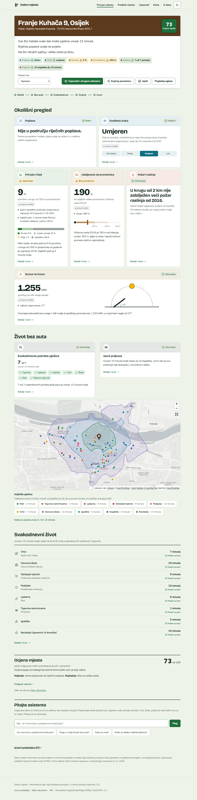
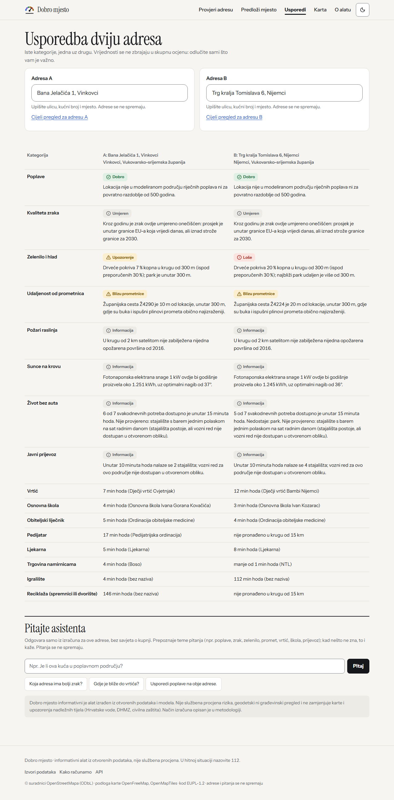
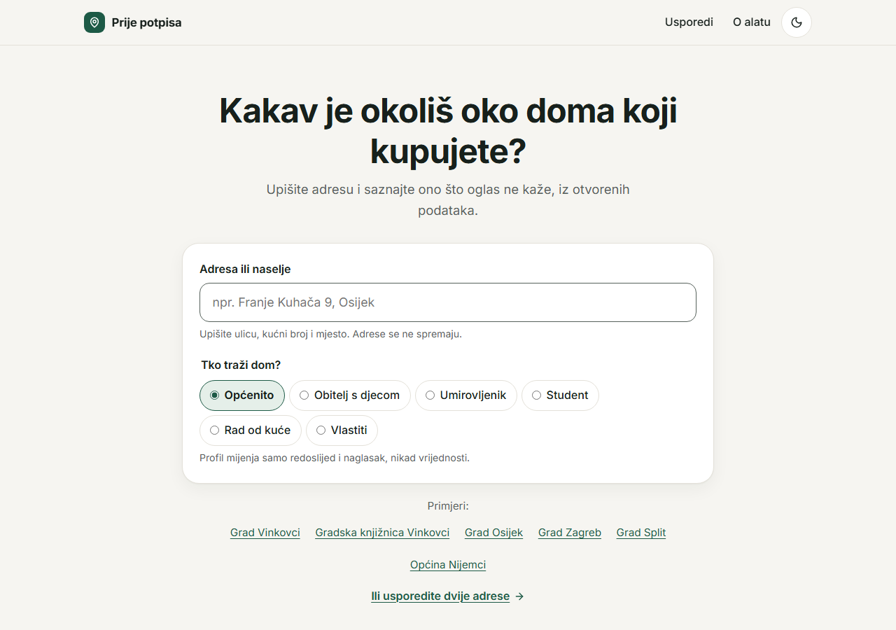
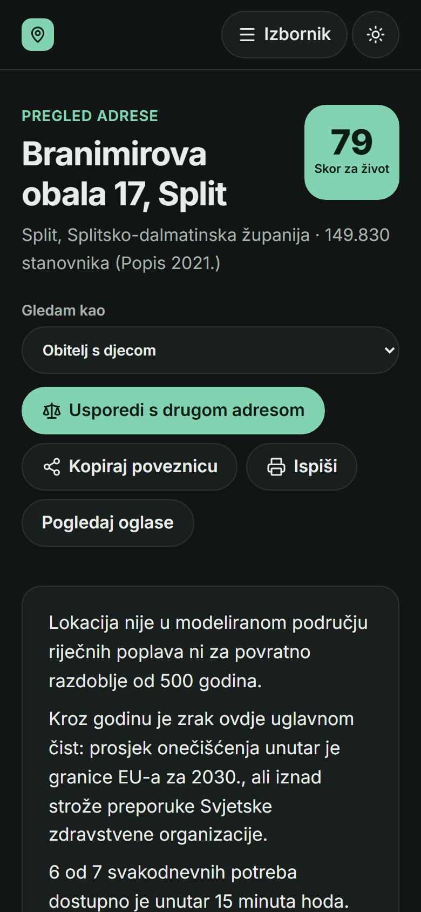
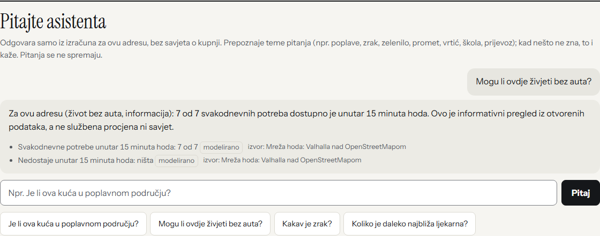
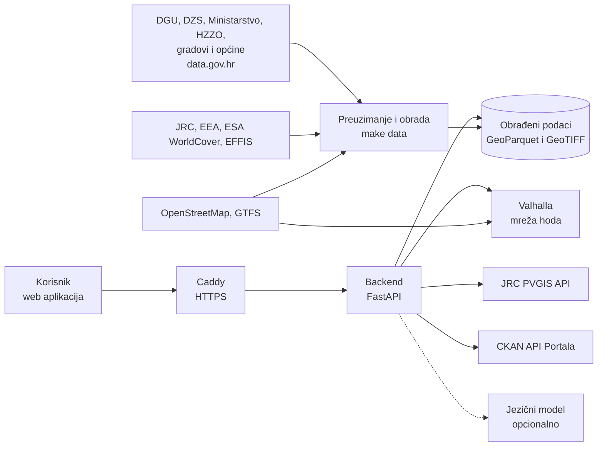

# Prije potpisa

**Okolišni pregled kuće ili stana prije kupnje: poplave, zrak, toplina i zelenilo, buka, sunce na krovu i život bez auta, za bilo koju adresu u Hrvatskoj, iz otvorenih podataka.**

Datathon Portala otvorenih podataka 2026 · Izazov B: Okoliš i održivi prostor
Tim: TODO(tim) · Mentor: TODO(tim) · Visoko učilište: TODO(tim)

**Demo:** TODO(ljudi): javni URL nakon postavljanja na poslužitelj (vidi [docs/DEPLOY.md](docs/DEPLOY.md))



---

## Problem

Kupnja kuće ili stana najveća je financijska odluka većine ljudi. Pri odabiru se gleda cijena, kvadratura i lokacija. Okolišne rizike i ovisnost o autu ljudi najčešće otkriju tek kad usele: da je kuća u poplavnom području, da je zrak lošiji nego što su mislili, da nema hlada ni zelenila, da se do vrtića i trgovine ne može bez auta.

Ti podaci postoje, ali su rasuti po različitim institucijama i formatima: karte poplava, karte kvalitete zraka, satelitski pokrov tla, registri vrtića i ordinacija, vozni redovi. Prosječnom kupcu nisu ni razumljivi ni usporedivi.

## Rješenje

Korisnik upiše adresu i, po želji, odabere tko je: obitelj s djecom, umirovljenik, student, netko tko radi od kuće ili vlastiti izbor. Dobiva pregled u tri dijela:

1. **Okolišni pregled** (prvi ekran):
   - **poplave:** nalazi li se lokacija ili njezina okolica od 100 m u modeliranom poplavnom području za povratna razdoblja od 10, 100 i 500 godina, s poveznicom na službene karte Hrvatskih voda;
   - **zrak:** godišnje koncentracije PM2,5 i NO2 za 2024. uspoređene sa smjernicama Svjetske zdravstvene organizacije i graničnim vrijednostima EU-a za 2030.;
   - **toplina i zelenilo:** udio drveća, zelenih i izgrađenih površina u krugu od 300 m te najbliži park u minutama hoda, prema pravilu 3-30-300;
   - **buka:** procjena prema udaljenosti od autocesta, glavnih i važnijih cesta te pruga, jasno označena kao procjena, uz poveznicu na strateške karte buke EEA-e;
   - **požari raslinja:** opožarene površine u krugu od 2 km od 2016. (Copernicus EFFIS);
   - **sunce na krovu:** procijenjena godišnja proizvodnja solarne elektrane po kilovatu snage (JRC PVGIS).
2. **Život bez auta:**
   - što je na 5, 10 i 15 minuta hoda po stvarnoj mreži ulica (karta s izokronama i isti popis u tekstu);
   - stajališta javnog prijevoza s brojem polazaka na sat iz voznih redova ZET-a, HŽPP-a i Autotroleja;
   - koliko od sedam svakodnevnih potreba lokacija pokriva bez auta.
3. **Svakodnevni život:** najbliži vrtić, osnovna škola, obiteljski liječnik, pedijatar, ljekarna, trgovina namirnicama, igralište i mjesto za reciklažu, s minutama hoda i brojem unutar 15 minuta.

Dvije adrese mogu se usporediti jedna uz drugu. Pregled se može ispisati, podijeliti poveznicom ili preuzeti kao GeoJSON. Asistent odgovara na pitanja poput „Je li ova kuća u poplavnom području?” ili „Mogu li ovdje živjeti bez auta?”.

Svaka brojka ima izvor, datum preuzimanja i vrstu (izmjereno, modelirano ili procjena). Brojke računa backend iz podataka, a ne jezični model. Rješenje ne daje jednu skupnu ocjenu sa skrivenim težinama: svaka kategorija ima vlastito, razumljivo značenje. Odabrani profil mijenja samo redoslijed i naglasak, nikad činjenice.

## Primjer

Usporedba dviju adresa javnih ustanova u Vukovarsko-srijemskoj županiji. Izračunato 3. 11. 2026. iz podataka preuzetih 1.–2. 11. 2026.:
- kvaliteta zraka: EEA karta za 2024.;
- pokrov tla: ESA WorldCover 2021.;
- poplave: JRC v3.1.1;
- OpenStreetMap: izvadak od 1. 11. 2026.

| | Grad Vinkovci, Bana Jelačića 1 | Općina Nijemci, Trg kralja Tomislava 6 |
|---|---|---|
| Naselje | Vinkovci, 28.111 stanovnika (Popis 2021.) | Nijemci, 1.330 stanovnika (Popis 2021.) |
| Poplave | **Dobro:** izvan modeliranih područja za 10, 100 i 500 godina, i u krugu od 100 m | **Dobro:** isto |
| Zrak (godišnji prosjek 2024.) | **Loše:** PM2,5 18,2 µg/m³ (WHO 5, EU 2030. 10), NO2 17,5 µg/m³ | **Loše:** PM2,5 18,6 µg/m³, NO2 16,5 µg/m³ |
| Toplina i zelenilo (300 m) | **Upozorenje:** drveće 7 %, izgrađeno 90 %; park 2 min hoda | **Loše:** drveće 20 %; najbliži park udaljen 6,1 km |
| Buka (procjena) | važnija cesta 10 m, pruga 1,4 km | važnija cesta 20 m |
| Sunce na krovu | oko 1.251 kWh po kWp godišnje, nagib 37° | oko 1.245 kWh po kWp godišnje, nagib 36° |
| Život bez auta | 6 od 7 potreba unutar 15 min; stajalište s polascima nije provjereno (nema otvorenog voznog reda) | 5 od 7; nedostaje park; stajalište nije provjereno |
| Najbliži vrtić / škola / liječnik | 3 / 4 / 5 min hoda | 12 / 3 / 4 min hoda |
| Pedijatar | 19 min hoda | nije pronađen u krugu od 15 km |

Isti izračun dobiva se pozivom `GET /api/report?lat=45.288186&lon=18.805681` (Vinkovci) i `GET /api/report?lat=45.140273&lon=19.034942` (Nijemci). Svih šest demo adresa (Vinkovci, Osijek, Zagreb, Split, Nijemci) nalazi se u [scripts/demo_addresses.json](scripts/demo_addresses.json), a njihovi rezultati provjeravaju se zlatnim testovima.



## Za koga

- **Kupci i najmoprimci** koji biraju između više lokacija.
- **Obitelji s djecom i starije osobe**, kojima su blizina vrtića, škole, liječnika i ljekarne te javni prijevoz važni koliko i sama kuća.
- **Oglasnici nekretnina, agencije i banke**, koji pregled mogu ugraditi preko otvorenog API-ja.

## Funkcionalnosti

- pretraga adrese s prijedlozima nad 1,7 milijuna adresa Državne geodetske uprave (bez vanjskog geokodera)
- okolišni pregled: poplave, zrak, toplina i zelenilo, buka, požari raslinja, sunčev potencijal
- izokrone hoda od 5, 10 i 15 minuta po mreži ulica i pješačkih staza
- svakodnevne potrebe i javni prijevoz s minutama hoda
- profili korisnika koji mijenjaju redoslijed i naglasak
- usporedba dviju adresa
- asistent na hrvatskom koji odgovara samo iz rezultata izračuna (s jezičnim modelom ili bez njega)
- ispis, dijeljenje poveznicom (stanje izvještaja je u URL-u) i preuzimanje GeoJSON-a
- stranica „Izvori”: datumi osvježavanja uživo preko CKAN API-ja Portala otvorenih podataka i nalazi o kvaliteti podataka
- pristupačnost: WCAG 2.2 razine AA (axe bez nalaza na svim stranicama u svijetloj i tamnoj temi), mobilni prikaz od 320 px, tamna tema; sve što je na karti dostupno je i u tekstu

| Naslovnica | Mobitel, tamna tema | Asistent |
|---|---|---|
|  |  |  |

## Izvori otvorenih podataka

Potpun popis s poveznicama, licencama, datumima i statusom svakog izvora nalazi se u [docs/IZVORI_PODATAKA.md](docs/IZVORI_PODATAKA.md). Ukupno se koristi 30 skupova podataka i PVGIS API.

| Izvor | Podaci | Primjena |
|---|---|---|
| DGU (data.gov.hr) | Adrese INSPIRE, Upravne jedinice INSPIRE | geokodiranje; naselje, grad ili općina i županija za adresu |
| DZS (data.gov.hr) | Popis stanovništva 2021., stanovništvo po naseljima | broj stanovnika naselja |
| Ministarstvo znanosti, obrazovanja i mladih (data.gov.hr) | Registar dječjih vrtića, popis osnovnih škola | vrtići i škole (geokodirani) |
| Grad Zagreb (data.gov.hr) | Geoportal: dječji vrtići, osnovne škole, reciklažna dvorišta | vrtići, škole i reciklaža u Zagrebu |
| HZZO | ugovorne ordinacije opće/obiteljske medicine i pedijatrije, ugovorne ljekarne | liječnici, pedijatri i ljekarne (geokodirani) |
| JRC | karte opasnosti od riječnih poplava za Europu | poplave |
| Hrvatske vode | karte opasnosti od poplava | poveznica na službeni preglednik |
| EEA | interpolirane karte kvalitete zraka 2024. | PM2,5 i NO2 |
| ESA WorldCover | pokrov tla, 10 m | zelenilo, drveće, izgrađenost |
| EEA (direktiva o buci okoliša) | strateške karte buke | samo poveznica (licenca nije otvorena) |
| JRC PVGIS | sunčev potencijal (API) | sunce na krovu |
| Copernicus EFFIS | opožarene površine (WFS) | požari raslinja |
| ZET, HŽPP (GTFS), Autotrolej (JSON, data.gov.hr) | vozni redovi | polasci na sat |
| OpenStreetMap | mreža ulica, trgovine, igrališta, parkovi, stajališta, prometnice, reciklaža | mreža hoda, svakodnevne potrebe, procjena buke |
| Općine i gradovi (data.gov.hr) | reciklažna dvorišta i zeleni otoci (11 skupova s koordinatama) | reciklaža |
| Portal otvorenih podataka | CKAN API | pretraga skupova i datumi osvježavanja uživo |

## Povezivanje podataka

Upisana adresa pretvara se u koordinate preko adresa DGU-a. Koordinate se zatim povezuju s naseljem, gradom ili općinom i županijom (DGU) i s brojem stanovnika naselja (DZS). Na toj točki čitaju se rasterski slojevi JRC-a, EEA-e i ESA WorldCovera.

Mreža ulica iz OpenStreetMapa određuje do čega se stvarno može doći pješice. Na nju se vežu:
- vrtići i škole iz registra Ministarstva, geokodirani nad adresama DGU-a jer registri nemaju koordinate;
- ordinacije i ljekarne iz popisa HZZO-a, također geokodirane;
- stajališta i polasci iz voznih redova;
- trgovine i parkovi iz OpenStreetMapa.

Reciklažna dvorišta koja općine objavljuju u različitim formatima pronalaze se preko CKAN API-ja i spajaju s OpenStreetMapom u jedan sloj.

Iz tih spojenih podataka nastaje informacija koju danas nije moguće dobiti na jednom mjestu: kakav je okoliš oko određene kuće i može li se ondje živjeti bez auta.

Način izračuna, pragovi i ograničenja opisani su u [docs/METODOLOGIJA.md](docs/METODOLOGIJA.md).

## Arhitektura



- **Obrada podataka** jednom preuzima i priprema nacionalne slojeve. Odgovor za adresu zato ne ovisi o dostupnosti izvora u trenutku upita. Cijela obrada pokreće se naredbom `make data`.
- **Mreža hoda** računa se u Valhalli, otvorenom usmjerivaču nad OpenStreetMapom. Jedan izvještaj šalje jedan upit matrice za sve ustanove i jedan upit izokrona; izmjereno trajanje izvještaja je oko 1 s.
- **API** je REST s OpenAPI opisom (`/api/docs`). Svaka vrijednost u odgovoru nosi izvor, datum i vrstu (izmjereno, modelirano ili procjena).
- **Asistent** je opcionalan i koristi bilo koji model preko OpenAI-kompatibilnog API-ja. Bez modela pitanja razumiju jednostavna pravila. Brojke uvijek dolaze iz predložaka.

Detalji, standardi te tehnički, organizacijski i pravni preduvjeti za uvođenje nalaze se u [docs/ARHITEKTURA.md](docs/ARHITEKTURA.md).

## Tehnologije

Python 3.12 · FastAPI · Pydantic · rasterio · Shapely · GeoPandas · pyosmium · PyArrow · httpx · pytest · ruff · mypy (strict) · Valhalla · React 19 + TypeScript (Vite) · React Router · TanStack Query · MapLibre GL JS · OpenFreeMap · Playwright + axe-core · ESLint (typescript-eslint, jsx-a11y) · Docker Compose · Caddy

## Pokretanje

Preduvjeti: Docker s Composeom, `make`, [uv](https://docs.astral.sh/uv/) i Node.js 22+. Na Windowsima `make` dolazi npr. iz MSYS2 ili Git for Windows SDK-a.

```bash
cp .env.example .env     # CONTACT_EMAIL za User-Agent; LLM_* samo ako želite asistenta s jezičnim modelom
make setup               # ovisnosti backenda i frontenda
make data                # preuzimanje i obrada svih izvora (prvi put oko 20 minuta i 2,6 GB preuzimanja; vidi docs/IZVORI_PODATAKA.md)
make dev                 # Valhalla, backend na http://localhost:8000 i frontend na http://localhost:5173
make verify              # lint, tipovi, testovi, build, e2e i pristupačnost
```

Pri prvom pokretanju (`make dev` ili `make valhalla`) Valhalla oko 3 minute gradi pločice iz OSM izvatka.

Detaljna uputa korak po korak za Windows i VS Code, bez `make`a, s radom u granama: [docs/RAZVOJ.md](docs/RAZVOJ.md).

Produkcija:

```bash
docker compose -f deploy/docker-compose.yml up -d --build
```

Upute za poslužitelj, domenu i prijenos obrađenih podataka nalaze se u [docs/DEPLOY.md](docs/DEPLOY.md).

## Struktura repozitorija

```
backend/    app/ (API), ingest/ (konektori izvora), analysis/ (izračuni), tests/
frontend/   React aplikacija
deploy/     Docker Compose, Caddy, Dockerfileovi, Valhalla
docs/       metodologija, arhitektura, izvori, kvaliteta podataka, pristupačnost, asistent, odluke, scenarij videa, predaja, images/
scripts/    provjera README-a, demo adrese, prijenos podataka na poslužitelj
```

## Uklapanje u postojeće sustave

- API s OpenAPI opisom može se ugraditi u oglasnike nekretnina, aplikacije banaka za stambene kredite ili mrežne stranice gradova.
- Izvještaj je dostupan i kao GeoJSON za GIS alate (`/api/report?…&format=geojson`).
- Spojeni sloj reciklažnih dvorišta iz općinskih skupova može se vratiti na Portal kao jedan nacionalni skup.
- Geokodirani registri vrtića, škola, ordinacija i ljekarni mogli bi se vratiti izdavačima kao prijedlog koordinata za njihove skupove.

## Kvaliteta podataka na Portalu

Provjereno 2. i 3. 11. 2026. tijekom automatske obrade:

- **Registri bez koordinata:** registar dječjih vrtića, popis osnovnih škola i HZZO-ovi popisi ordinacija i ljekarni. Naše geokodiranje nad adresama DGU-a uspijeva za 86–95 % zapisa; najslabije za ljekarne (86,3 %).
- **Registri pravnih osoba umjesto lokacija:** registar vrtića za Zagreb ima 199 redaka, a gradski geoportal 323 objekta. Popis škola nema područne škole.
- **Općinski podaci o otpadu:** od 33 skupa o reciklažnim dvorištima i zelenim otocima samo 11 ima upotrebljive koordinate. Ostali su PDF-ovi, poveznice na web stranice ili tablice bez koordinata, jedan skup ima koordinate u neispravnom obliku broja, a dva imaju točke s koordinatama izvan Hrvatske.
- **Neispravne poveznice:**
  - vozni red HŽPP-a na Portalu vraća 404 (datoteka na stranicama HŽPP-a radi);
  - ATOM resurs adresa DGU-a ima praznu poveznicu;
  - „GeoJSON” resurs vrtića Grada Zagreba vodi na drugi format.
- **Licence:** HZZO-ovi popisi i vozni red HŽPP-a nemaju navedenu licencu; JRC karte poplava navode dvije različite licence.
- **Zastarjelost:** HZZO-ov popis ugovornih ljekarni zadnji je put izmijenjen u rujnu 2023.

Cijeli popis vodi se u [docs/KVALITETA_PODATAKA.md](docs/KVALITETA_PODATAKA.md).

## Usklađenost s kriterijima ocjenjivanja

| Kriterij | Kako ga rješenje ispunjava |
|---|---|
| Upotreba otvorenih podataka | 30 skupova podataka i PVGIS API; izvori se preuzimaju automatski (CKAN Portala, ATOM DGU-a, PVGIS, GTFS) i pripremaju jednom naredbom, uz zapis licence i datuma; prednost imaju skupovi s data.gov.hr |
| Povezivanje javno dostupnih podataka | adresa se povezuje s upravnim jedinicama, popisom stanovništva, rasterskim okolišnim slojevima, mrežom ulica, registrima ustanova (geokodiranim nad adresama DGU-a) i voznim redovima |
| Relevantnost rješenja | poplave, kvaliteta zraka, buka, zelenilo i toplina, požari raslinja, okolišno prihvatljiv prijevoz, reciklaža i sunčeva energija, sve teme izazova B |
| Utjecaj i korist za zajednicu | okolišni rizici i ovisnost o autu vidljivi su prije najveće financijske odluke, a ne nakon useljenja; nalazi o kvaliteti podataka vraćaju se izdavačima |
| Inovativnost i primjena tehnologija | izokrone hoda po stvarnoj mreži, spajanje satelitskih i registarskih podataka za jednu adresu, vlastito geokodiranje registara, asistent čije brojke dolaze iz predložaka |
| Izvedivost rješenja | radni prototip, cijela obrada pokreće se jednom naredbom, produkcija jednom Docker Compose naredbom; javni demo: TODO(ljudi) |
| Tehnička arhitektura i integracijski potencijal | REST i OpenAPI, GeoJSON, INSPIRE i GTFS na ulazu, opisani tehnički, organizacijski i pravni preduvjeti za uvođenje, Docker Compose |
| Dojam rješenja | jedna adresa, jedan pregled; okolišni pregled na prvom ekranu; usporedba dviju adresa; WCAG 2.2 AA provjeren axe-om u svijetloj i tamnoj temi |
| Prezentacija rješenja | video u trajanju do 3 minute: TODO(ljudi) (scenarij: [docs/VIDEO_SCENARIJ.md](docs/VIDEO_SCENARIJ.md)) |

## Privatnost i sigurnost

- Upisane adrese, koordinate i pitanja asistentu ne spremaju se: API i Caddy ne vode pristupni zapis, a nema ni kolačića za praćenje ni analitike.
- Iz HZZO-ovih popisa ne prikazuju se imena liječnika, a iz popisa škola imena ravnatelja.
- U demo materijalima koriste se isključivo adrese javnih ustanova.
- Ključevi se nikad ne spremaju u repozitorij (samo `.env`, koji je u `.gitignore`).

## Poznata ograničenja

- Ovo je informativni alat, a ne službena procjena rizika, geodetski ni građevinski pregled. Ne zamjenjuje karte i upozorenja Hrvatskih voda, DHMZ-a i civilne zaštite.
- Karte poplava su modelirane i obuhvaćaju samo riječne poplave većih vodotoka (bez bujica i poplava mora). Lokacija izvan modeliranog područja ne znači da rizika nema.
- Kvaliteta zraka prikazuje se kao godišnji prosjek modelirane karte na mreži od 1 km, a ne kao mjerenje na samoj adresi.
- Buka je samo procjena prema udaljenosti od prometnica: strateške karte buke EEA-e nemaju otvorenu licencu, pa ih samo povezujemo.
- Vozni redovi u otvorenom obliku postoje za ZET, HŽPP i Autotrolej. Drugdje, npr. u Splitu i Osijeku, prikazuju se samo stajališta, a potreba „stajalište s polascima” označava se kao „nije provjereno”. Vozni red HŽPP-a vrijedi do 13. 12. 2026.
- Registri bez koordinata geokodirani su s 86–95 % uspjeha. Neuspjeli zapisi se ne prikazuju, a za vrtiće, škole i ljekarne dopunjuju se OpenStreetMapom.
- HZZO-ovi popisi i vozni red HŽPP-a nemaju navedenu licencu; koriste se uz obrazloženje u [docs/ODLUKE.md](docs/ODLUKE.md).
- Sunce na krovu dolazi uživo iz PVGIS-a. Kad servis sporo odgovara, kategorija privremeno prikazuje „Nema podataka” dok rezultat ne stigne.
- OpenStreetMap je izvan gradova nepotpun, pa „nije pronađeno” može značiti i da objekt nije ucrtan; pregled to navodi.
- Pristupačnost je provjerena automatski (axe-core, tipkovnica, 320 px). Provjera s čitačima zaslona i korisnicima još nije provedena.

## Daljnji razvoj

- odabir točke klikom na kartu i lokacija iz preglednika
- obavijest kad se za odabranu lokaciju promijeni službena karta opasnosti od poplava
- strateške karte buke ako postanu dostupne pod otvorenom licencom
- vozni redovi ostalih gradskih prijevoznika (GTFS)
- ugradnja u oglasnike nekretnina preko API-ja
- dodatni slojevi: toplinski stres, kvaliteta vode za piće
- usporedba više od dviju adresa

## Licenca i atribucija

- **Kod:** EUPL-1.2 ([LICENSE](LICENSE)).
- **Podaci:** svaki izvor zadržava vlastite uvjete; atribucije i licence navedene su u [docs/IZVORI_PODATAKA.md](docs/IZVORI_PODATAKA.md).
  - Podaci OpenStreetMapa: © suradnici OpenStreetMapa, ODbL.
  - Podloga karte: OpenFreeMap, © OpenMapTiles.
  - ESA WorldCover: © ESA WorldCover project 2021 / Contains modified Copernicus Sentinel data (2021) processed by ESA WorldCover consortium.
  - PVGIS © European Communities, 2001–2026.

## Korišteni AI alati

Za pisanje koda i dokumentacije korišten je Claude Code (Anthropic). Asistent u aplikaciji može koristiti bilo koji model preko OpenAI-kompatibilnog API-ja i ne ovisi o jednom pružatelju; bez modela radi s pravilima.

## Ograničenje odgovornosti

Prije potpisa informativni je alat izrađen na Datathonu Portala otvorenih podataka 2026. Procjene se temelje na otvorenim podacima i modelima i nisu službena procjena. U hitnoj situaciji nazovite 112.
