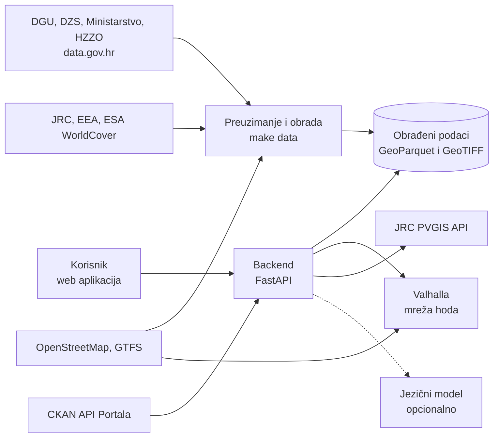

# Prije potpisa

**Okolišni pregled kuće ili stana prije kupnje: poplave, zrak, toplina i zelenilo, buka, sunce na krovu i život bez auta, za bilo koju adresu u Hrvatskoj, iz otvorenih podataka.**

Datathon Portala otvorenih podataka 2026 · Izazov B: Okoliš i održivi prostor
Tim: TODO(tim) · Mentor: TODO(tim) · Visoko učilište: TODO(tim)

**Demo:** TODO(ljudi): javni URL nakon postavljanja na poslužitelj (vidi [docs/DEPLOY.md](docs/DEPLOY.md))

---

## Problem

Kupnja kuće ili stana najveća je financijska odluka većine ljudi. Pri odabiru se gleda cijena, kvadratura i lokacija, a okolišne rizike i to koliko se svakodnevno ovisi o autu ljudi najčešće otkriju tek kad usele: da je kuća u poplavnom području, da je zrak lošiji nego što su mislili, da nema hlada ni zelenila, da je do vrtića i trgovine nemoguće bez auta.

Ti podaci postoje, ali su rasuti po različitim institucijama i formatima (karte poplava, karte kvalitete zraka, satelitski pokrov tla, registri vrtića i ordinacija, vozni redovi) i prosječnom kupcu nisu razumljivi ni usporedivi.

## Rješenje

Korisnik upiše adresu i odabere tko je (obitelj s djecom, umirovljenik, student, netko tko radi od kuće). Dobiva pregled u tri dijela:

1. **Okolišni pregled** (prvi ekran):
   - **poplave:** nalazi li se lokacija u modeliranom poplavnom području za povratna razdoblja od 10, 100 i 500 godina, s poveznicom na službene karte Hrvatskih voda;
   - **zrak:** godišnje koncentracije PM2,5 i NO2 uspoređene sa smjernicama Svjetske zdravstvene organizacije i graničnim vrijednostima EU-a za 2030.;
   - **toplina i zelenilo:** udio drveća, zelenih i izgrađenih površina u krugu od 300 m te najbliži park u minutama hoda;
   - **buka:** razine iz strateških karata buke gdje postoje, a drugdje udaljenost od glavnih cesta i pruga, jasno označena kao procjena;
   - **sunce na krovu:** procijenjena godišnja proizvodnja solarne elektrane po kilovatu snage.
2. **Život bez auta:** što je na 5, 10 i 15 minuta hoda po stvarnoj mreži ulica, stajališta javnog prijevoza s brojem polazaka i koliko svakodnevnih potreba lokacija pokriva bez auta.
3. **Svakodnevni život:** najbliži vrtić, osnovna škola, obiteljski liječnik i pedijatar, ljekarna, trgovina namirnicama i igralište, s minutama hoda.

Dvije adrese mogu se usporediti jedna uz drugu, pregled se može ispisati ili podijeliti poveznicom, a asistent odgovara na pitanja poput „Je li ova kuća u poplavnom području?” ili „Mogu li ovdje živjeti bez auta?”.

Svaka brojka ima izvor i datum. Brojke računa backend iz podataka, a ne jezični model. Rješenje ne daje jednu skupnu ocjenu sa skrivenim težinama: svaka kategorija ima vlastito, razumljivo značenje, a odabrani profil mijenja samo redoslijed i naglasak, nikad činjenice.

<!-- AUTO: ovdje dodati odjeljak „Primjer” sa stvarnim izračunom za jednu ili dvije demo adrese (adrese javnih ustanova), s datumom podataka. Ništa ne izmišljati. -->

## Za koga

- **Kupci i najmoprimci** koji biraju između više lokacija.
- **Obitelji s djecom i starije osobe**, kojima su blizina vrtića, škole, liječnika i ljekarne te javni prijevoz važni koliko i sama kuća.
- **Oglasnici nekretnina, agencije i banke**, koji pregled mogu ugraditi preko otvorenog API-ja.

## Funkcionalnosti

- pretraga adrese s prijedlozima i odabir točke na karti
- okolišni pregled: poplave, zrak, toplina i zelenilo, buka, sunčev potencijal
- izokrone hoda od 5, 10 i 15 minuta po mreži ulica i pješačkih staza
- svakodnevne potrebe i javni prijevoz s minutama hoda
- profili korisnika koji mijenjaju redoslijed i naglasak
- usporedba dviju adresa
- asistent na hrvatskom koji odgovara samo iz rezultata izračuna
- ispis i dijeljenje poveznicom
- stranica „Izvori”: datumi osvježavanja uživo preko CKAN API-ja Portala otvorenih podataka i nalazi o kvaliteti podataka
- pristupačnost: WCAG 2.2 razine AA, mobilni prikaz od 320 px, tamna tema, sve što je na karti dostupno je i u tekstu

## Izvori otvorenih podataka

Potpun popis s poveznicama, licencama, datumima preuzimanja i statusom svakog izvora nalazi se u [docs/IZVORI_PODATAKA.md](docs/IZVORI_PODATAKA.md).

| Izvor | Podaci | Primjena |
|---|---|---|
| DGU (data.gov.hr) | upravne jedinice (INSPIRE), adrese | geokodiranje, naselje i općina za adresu |
| DZS (data.gov.hr) | Popis stanovništva 2021. | kontekst naselja |
| Ministarstvo znanosti, obrazovanja i mladih (data.gov.hr) | Registar dječjih vrtića, popis škola | vrtići i škole |
| HZZO | ugovorne ordinacije primarne zdravstvene zaštite | obiteljski liječnici i pedijatri |
| JRC | karte opasnosti od poplava za Europu | poplave |
| Hrvatske vode | karte opasnosti od poplava | poveznica na službeni preglednik |
| EEA | interpolirane karte kvalitete zraka | PM2,5 i NO2 |
| ESA WorldCover | pokrov tla, 10 m | zelenilo, drveće, izgrađenost |
| EEA (direktiva o buci okoliša) | strateške karte buke | buka, gdje postoje |
| JRC PVGIS | sunčev potencijal | sunce na krovu |
| ZET, Autotrolej, HŽPP | vozni redovi u GTFS obliku | javni prijevoz |
| OpenStreetMap | mreža ulica, trgovine, parkovi, stajališta, reciklaža | mreža hoda i svakodnevne potrebe |
| Općine i gradovi (data.gov.hr) | reciklažna dvorišta i zeleni otoci | reciklaža |
| Portal otvorenih podataka | CKAN API | datumi osvježavanja izvora uživo |

## Povezivanje podataka

Upisana adresa pretvara se u koordinate, a zatim u naselje, općinu i županiju (DGU). Na toj točki čitaju se rasterski slojevi (JRC, EEA, ESA WorldCover). Mreža ulica iz OpenStreetMapa određuje do čega se stvarno može doći pješice. Na nju se vežu vrtići i škole iz registra Ministarstva, ordinacije iz popisa HZZO-a, stajališta i polasci iz voznih redova te trgovine i parkovi iz OpenStreetMapa. Reciklažna dvorišta koja općine objavljuju u različitim formatima spajaju se u jedan sloj.

Iz tih spojenih podataka nastaje informacija koju danas nije moguće dobiti na jednom mjestu: kakav je okoliš oko određene kuće i može li se ondje živjeti bez auta.

Način izračuna, pragovi i ograničenja opisani su u [docs/METODOLOGIJA.md](docs/METODOLOGIJA.md).

## Arhitektura



- **Obrada podataka** jednom preuzima i priprema nacionalne slojeve, pa odgovor za adresu ne ovisi o dostupnosti izvora u trenutku upita.
- **Mreža hoda** računa se u Valhalli, otvorenom usmjerivaču nad OpenStreetMapom.
- **API** je REST s OpenAPI opisom; svaka vrijednost u odgovoru nosi izvor, datum i vrstu (izmjereno, modelirano ili procjena).
- **Asistent** je opcionalan i koristi otvoreni model preko OpenAI-kompatibilnog API-ja. Bez modela pitanja razumiju jednostavna pravila. Brojke uvijek dolaze iz predložaka.

Detalji, standardi te tehnički, organizacijski i pravni preduvjeti za uvođenje nalaze se u [docs/ARHITEKTURA.md](docs/ARHITEKTURA.md).

## Tehnologije

Python 3.12 · FastAPI · Pydantic · rasterio · Shapely · GeoPandas · PyArrow · httpx · pytest · ruff · mypy (strict) · Valhalla · React 19 + TypeScript (Vite) · React Router · TanStack Query · MapLibre GL JS · OpenFreeMap · Playwright + axe-core · ESLint (typescript-eslint, jsx-a11y) · Docker Compose · Caddy

## Pokretanje

Preduvjeti: Docker s Composeom, `make`, [uv](https://docs.astral.sh/uv/) i Node.js 22+.

```bash
cp .env.example .env     # CONTACT_EMAIL za User-Agent; LLM_* samo ako želite asistenta s jezičnim modelom
make setup               # ovisnosti backenda i frontenda
make data                # preuzimanje i obrada svih izvora (prvi put dulje traje; vidi docs/IZVORI_PODATAKA.md)
make dev                 # Valhalla, backend na http://localhost:8000 i frontend na http://localhost:5173
make verify              # lint, tipovi, testovi, build, e2e i pristupačnost
```

Produkcija:

```bash
docker compose -f deploy/docker-compose.yml up -d --build
```

Upute za poslužitelj, domenu i prijenos obrađenih podataka nalaze se u [docs/DEPLOY.md](docs/DEPLOY.md).

## Struktura repozitorija

```
backend/    FastAPI, preuzimanje i obrada podataka, izračuni, testovi
frontend/   React aplikacija
deploy/     Docker Compose, Caddy, Valhalla
docs/       metodologija, arhitektura, izvori, kvaliteta podataka, pristupačnost, odluke, scenarij videa
scripts/    pomoćne skripte (provjera README-a, snimke zaslona, demo adrese)
```

## Uklapanje u postojeće sustave

- API s OpenAPI opisom može se ugraditi u oglasnike nekretnina, aplikacije banaka za stambene kredite ili mrežne stranice gradova.
- Izvještaj je dostupan i kao GeoJSON za GIS alate.
- Spojeni sloj reciklažnih dvorišta iz općinskih skupova može se vratiti na Portal kao jedan nacionalni skup.

## Kvaliteta podataka na Portalu

<!-- AUTO: kratki popis stvarnih nalaza iz docs/KVALITETA_PODATAKA.md (nedosljedni formati, zastarjeli skupovi, nedostajuće koordinate, neispravne poveznice), s datumom provjere. -->

Cijeli popis vodi se u [docs/KVALITETA_PODATAKA.md](docs/KVALITETA_PODATAKA.md).

## Usklađenost s kriterijima ocjenjivanja

| Kriterij | Kako ga rješenje ispunjava |
|---|---|
| Upotreba otvorenih podataka | izvori se preuzimaju automatski, izravno preko API-ja (CKAN Portala, PVGIS) ili kao preuzeti i pripremljeni skupovi, uz zapis licence i datuma |
| Povezivanje javno dostupnih podataka | adresa se povezuje s upravnim jedinicama, rasterskim okolišnim slojevima, mrežom ulica, registrima ustanova i voznim redovima |
| Relevantnost rješenja | poplave, kvaliteta zraka, buka, zelenilo, okolišno prihvatljiv prijevoz i sunčeva energija, sve teme izazova B |
| Utjecaj i korist za zajednicu | okolišni rizici i ovisnost o autu vidljivi su prije najveće financijske odluke, a ne nakon useljenja |
| Inovativnost i primjena tehnologija | izokrone hoda po stvarnoj mreži, spajanje satelitskih i registarskih podataka za jednu adresu, asistent čije brojke dolaze iz predložaka |
| Izvedivost rješenja | radni prototip, javni demo, cijela obrada pokreće se jednom naredbom |
| Tehnička arhitektura i integracijski potencijal | REST i OpenAPI, GeoJSON, opisani preduvjeti za uvođenje, Docker Compose |
| Dojam rješenja | jedna adresa, jedan pregled; okolišni pregled na prvom ekranu; usporedba dviju adresa; pristupačnost prema WCAG 2.2 AA |
| Prezentacija rješenja | video u trajanju do 3 minute: TODO(ljudi) |

## Privatnost i sigurnost

- Upisane adrese i pitanja asistentu ne spremaju se. Bilježi se samo anonimni broj upita po općini i kategoriji.
- Lokacija iz preglednika koristi se samo uz dopuštenje i ne sprema se.
- U demo materijalima koriste se isključivo adrese javnih ustanova.
- Ključevi se nikad ne spremaju u repozitorij.

## Poznata ograničenja

- Ovo je informativni alat, a ne službena procjena rizika, geodetski ni građevinski pregled. Ne zamjenjuje karte i upozorenja Hrvatskih voda, DHMZ-a i civilne zaštite.
- Karte poplava su modelirane; lokacija izvan modeliranog područja ne znači da rizika nema.
- Kvaliteta zraka prikazuje se kao godišnji prosjek modelirane karte, a ne kao mjerenje na samoj adresi.
- Strateške karte buke postoje samo za velike gradove i glavne prometnice; drugdje je buka procjena prema udaljenosti od prometnica.
- Vozni redovi u GTFS obliku postoje samo za neke prijevoznike; drugdje se prikazuju samo stajališta.
- OpenStreetMap je izvan gradova nepotpun, pa „nema u blizini” može značiti i da objekt nije ucrtan; pregled to navodi.

<!-- AUTO: nadopuniti stvarnim ograničenjima utvrđenim tijekom izrade (izvori koji nisu dostupni, izostavljene značajke). -->

## Daljnji razvoj

- obavijest kad se za odabranu lokaciju promijeni službena karta opasnosti od poplava
- ugradnja u oglasnike nekretnina preko API-ja
- dodatni slojevi: opožarene površine, toplinski stres, kvaliteta vode za piće
- usporedba više od dviju adresa

## Licenca i atribucija

- **Kod:** EUPL-1.2.
- **Podaci:** svaki izvor zadržava vlastite uvjete; atribucije i licence navedene su u [docs/IZVORI_PODATAKA.md](docs/IZVORI_PODATAKA.md). Podaci OpenStreetMapa: © suradnici OpenStreetMapa, ODbL. Podloga karte: OpenFreeMap, OpenMapTiles.

## Korišteni AI alati

Za pisanje i pregled koda i dokumentacije korišten je Claude Code (Anthropic). Tim je pregledao i testirao sav izlaz. Asistent u aplikaciji koristi otvoreni model preko OpenAI-kompatibilnog API-ja i ne ovisi o jednom pružatelju.

## Ograničenje odgovornosti

Prije potpisa informativni je alat izrađen na Datathonu Portala otvorenih podataka 2026. Procjene se temelje na otvorenim podacima i modelima i nisu službena procjena. U hitnoj situaciji nazovite 112.
