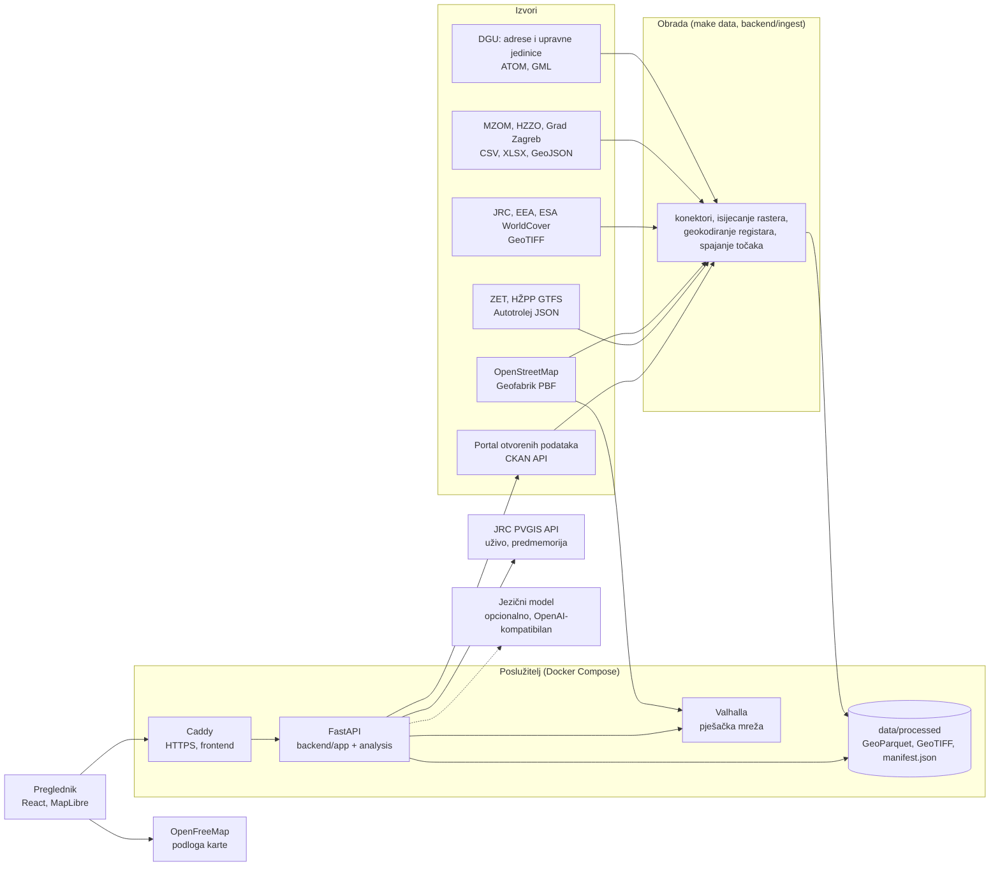

# Arhitektura

## Pregled

Rješenje ima dva dijela:
1. **Obrada podataka** (`make data`). Jednom preuzima i priprema nacionalne slojeve. Odgovor za adresu zato ne ovisi o dostupnosti izvora u trenutku upita.
2. **Posluživanje.** API čita pripremljene slojeve iz memorije i rastera, računa vremena hoda u Valhalli i uživo pita samo dva vanjska servisa: PVGIS (s predmemorijom) i CKAN API Portala (s predmemorijom i zadnjim dobrim odgovorom).

## Komponente

### Obrada (`backend/ingest/`)

| Modul | Izvor | Izlaz |
|---|---|---|
| `osm.py` | Geofabrik PBF (pyosmium, jedan prolaz, oko 1 min) | `osm_pois.parquet`, `osm_parks.parquet`, `osm_addresses.parquet`, `osm_noise_lines.parquet` |
| `dgu.py` | DGU ATOM ZIP (strujno čitanje GML-a od 2,6 GB bez raspakiravanja, oko 1 min) | `addresses.parquet` (1.683.411 adresa), `admin_units.parquet`, `settlements.parquet` |
| `rasters.py` | JRC, EEA, ESA WorldCover | isječci za Hrvatsku: `flood_rp{10,100,500}.tif`, `air_{pm25,no2}_2024.tif`, pločice WorldCover |
| `transit.py` | ZET i HŽPP GTFS, Autotrolej JSON | `transit_stops.parquet` s polascima na sat |
| `registries.py` | MZOM, HZZO, Grad Zagreb | `registry_pois.parquet` (geokodirano nad DGU adresama), `geocoding_report.json` |
| `recycling.py` | CKAN pretraga općinskih skupova + OSM | `recycling.parquet`, `recycling_ckan.json` |
| `centers.py` | OSM čvorovi `place` | stvarna središta naselja u `settlements.parquet` |
| `stations.py` | EEA Air Quality Download Service | `stations_2024.parquet`: godišnji prosjeci službenih postaja |
| `settlement_profiles.py` | sve gore (treba Valhallu) | `settlement_profiles.parquet`: profil središta 2.347 naselja za tražilicu |
| `pois.py` | sve gore | `pois.parquet`: jedan sloj točaka s prednošću službenih izvora |
| `common.py` | — | pristojno preuzimanje (User-Agent, razmak između zahtjeva, ponavljanje, nastavak prekinutog preuzimanja) i `manifest.json` s izvorom, licencom i datumom preuzimanja |

### API (`backend/app/`, `backend/analysis/`)

- **FastAPI**, Pydantic v2; OpenAPI na `/api/docs` i `/api/openapi.json`.
- Pri pokretanju se u memoriju učitavaju indeksi:
  - geokoder (ulice grupirane po prvim slovima riječi);
  - točke po kategorijama (NumPy, HTRS96/TM);
  - poligoni parkova, prometnice i upravne jedinice (Shapely `STRtree`).
- Rasteri se čitaju preko rasterio prozora oko točke.
- Jedan izvještaj radi ovo:
  - šalje jedan poziv matrice Valhalle za sve kandidate (oko 100–250 odredišta) i jedan poziv izokrona;
  - paralelno pita PVGIS (predmemorija po koordinatama zaokruženima na 0,01°);
  - čita šest rastera.
  - Izmjereno trajanje na demo adresama je oko 1 s s hladnom predmemorijom PVGIS-a i oko 0,1 s s toplom (cilj: ispod 2 s).

| Ruta | Opis |
|---|---|
| `GET /api/geocode?q=` | prijedlozi adresa, ulica i naselja |
| `GET /api/reverse?lat=&lon=` | naselje, grad ili općina, županija |
| `GET /api/report?lat=&lon=[&format=geojson]` | cijeli izvještaj; svaka vrijednost ima `source`, `retrieved_at` i `kind`; `nearby_places` su mjesta za kartu |
| `GET /api/route?from_lat=&from_lon=&to_lat=&to_lon=` | pješački put između dviju točaka kao GeoJSON `Feature` (`LineString`) s duljinom, minutama, brzinom hoda i izvorom; samo na zahtjev, ništa se ne sprema |
| `POST /api/assistant` | asistent nad izvještajem (vidi [ASISTENT.md](ASISTENT.md)) |
| `GET /api/find/options`, `POST /api/find` | Pronađi mjesto za život: filtri i deterministički rang naselja |
| `POST /api/find/parse` | slobodno pitanje u filtre (samo uz jezični model) |
| `GET /api/sources` | svi izvori s licencom i datumom |
| `GET /api/sources/live` | datumi zadnje izmjene skupova uživo s Portala (CKAN) |

### Zajednička konfiguracija (`config/`)

- `profiles.json`: profili i težine za Skor za život; čitaju ga i backend (`app/profiles.py`) i frontend.
- `listings.json`: slaganje poveznica na oglasnike (samo URL, bez dohvaćanja): kategorije, parametri filtara i iznimke slugova po oglasniku.
- `listing_locations.json`: UUID-ovi mjesta za Index Oglasi i imena gradova i općina koja postoje u više županija; puni ga `backend/ingest/listing_locations.py`, a aplikacija ga samo čita.

Podskorovi kategorija računaju se u backendu (`analysis/score.py`), pa isti skor koriste izvještaj i tražilica mjesta.

### Frontend (`frontend/`)

- React 19, TypeScript (strict), Vite, React Router, TanStack Query.
- MapLibre GL JS s podlogom OpenFreeMap (svijetla i tamna; mijenja se s temom bez gubitka slojeva).
- Pješački putevi na karti (`frontend/src/lib/route.ts`): jedan klijent za cijelu aplikaciju sprema rute u memoriju po polazištu i cilju zaokruženima na 5 decimala. Šalje najviše jedan zahtjev u sekundi, prekida prethodni zahtjev kad se odabere drugo mjesto (`AbortController`) i odustaje nakon 8 s. Backend pita isti Valhalla kao za izokrone; Valhalla nije javno izložena.
- Font Inter (OFL) poslužuje se iz vlastitog builda.
- Stanje izvještaja (koordinate, adresa, profil) je u URL-u, pa se svaka stranica može podijeliti ili ispisati.

### Postavljanje (`deploy/`)

Docker Compose s tri usluge: Caddy (HTTPS i statički frontend), API i Valhalla. Vidi [DEPLOY.md](DEPLOY.md).

## Standardi i interoperabilnost

| Područje | Standard |
|---|---|
| API | REST, OpenAPI 3.1 (automatski iz koda), JSON |
| Geopodaci u API-ju | GeoJSON (RFC 7946), WGS84 (EPSG:4326) |
| Ulazni geopodaci | INSPIRE GML 3.2.1 (adrese, upravne jedinice), GeoTIFF/COG, OSM PBF |
| Vozni redovi | GTFS Schedule |
| Katalog podataka | CKAN API (Portal otvorenih podataka) |
| Koordinatni sustavi | HTRS96/TM (EPSG:3765) za udaljenosti, ETRS89-LAEA (EPSG:3035) za EEA i INSPIRE |
| Pohrana obrađenih podataka | Apache Parquet (GeoParquet s WKB geometrijom), GeoTIFF |
| Pristupačnost | WCAG 2.2 razine AA |

Isti izvještaj dostupan je kao JSON za aplikacije i kao GeoJSON za GIS alate (QGIS, ArcGIS). API se može ugraditi u oglasnike nekretnina, aplikacije banaka za stambene kredite ili mrežne stranice gradova.

## Preduvjeti za uvođenje

### Tehnički

- Poslužitelj s Dockerom: 2 vCPU, 4 GB RAM-a i 10 GB diska su dovoljni za cijelu Hrvatsku. Za razvoj i obradu podataka potrebni su Python 3.12 s uv-om i Node.js 22+.
- Redovito osvježavanje podataka: `make data` jednom mjesečno. Vozni red HŽPP-a treba osvježiti nakon promjene voznog reda (13. 12. 2026.).
- Dostupnost vanjskih servisa: PVGIS i CKAN API. Ispad bilo kojeg od njih ne ruši izvještaj: sunce prikazuje „Nema podataka”, a stranica izvora zadnji poznati odgovor.
- Domena i TLS certifikat; Caddy ga dobiva automatski (Let's Encrypt).

### Organizacijski

- Vlasnik usluge, primjerice jedinica lokalne samouprave, županijska razvojna agencija ili tijelo nadležno za Portal, koji odgovara za ažurnost podataka i odgovara korisnicima.
- Dogovor s izdavačima o stabilnim poveznicama i redovitom objavljivanju: DGU, MZOM, HZZO, prijevoznici. Popis uočenih problema nalazi se u [KVALITETA_PODATAKA.md](KVALITETA_PODATAKA.md).
- Za veću korist: objava voznih redova ostalih gradskih prijevoznika u obliku GTFS te jedinstveni predložak za reciklažna dvorišta i zelene otoke.
- Proces za ispravke: korisnici prijavljuju pogrešne podatke, a vlasnik ih prosljeđuje izdavaču ili ispravlja u OpenStreetMapu.

### Pravni

- **Licence izvora** poštuju se i navode na stranici „Izvori” i u [IZVORI_PODATAKA.md](IZVORI_PODATAKA.md):
  - Otvorena dozvola RH;
  - CC BY 4.0 (EEA, ESA, JRC);
  - ODbL 1.0 (OpenStreetMap, JRC poplave): izvedene baze podataka iz OSM-a moraju ostati pod ODbL-om.
- **Izvori bez navedene licence** (HZZO, HŽPP GTFS): prije službenog uvođenja potrebna je pisana potvrda izdavača. Karte Hrvatskih voda samo se povezuju.
- **Ograničenje odgovornosti:** alat je informativan i ne zamjenjuje službene karte, procjene ni stručne preglede. Napomena je na svakom izvještaju.
- **Zaštita osobnih podataka (GDPR):** upisane adrese, koordinate i pitanja ne spremaju se, a pristupni zapisi su isključeni. Nema kolačića za praćenje ni analitike. Iz HZZO-ovih popisa ne prikazuju se imena liječnika. Iz popisa škola ne prikazuju se imena ravnatelja.
- **Kod** je objavljen pod licencom EUPL-1.2.
- **Pristupačnost:** Zakon o pristupačnosti mrežnih stranica i programskih rješenja za pokretne uređaje tijela javnog sektora (NN 17/19) traži usklađenost s normom EN 301 549 (WCAG). Rješenje je izrađeno prema WCAG 2.2 AA (vidi [PRISTUPACNOST.md](PRISTUPACNOST.md)).

## Kvaliteta koda

- **Backend:** ruff, mypy `--strict` i pytest. Testovi obuhvaćaju jedinične testove pragova, API ugovor, 20 pitanja asistenta i zlatne testove izvještaja za demo adrese.
- **Frontend:** ESLint (typescript-eslint strict s provjerom tipova i jsx-a11y strict), `tsc`, Vitest i Playwright s axe-core. Provjerava se glavni tok, usporedba, asistent, pogreške, 320 px bez vodoravnog pomicanja te axe na svim stranicama u svijetloj i tamnoj temi, na desktopu i mobitelu.
- `make verify` pokreće sve provjere i provjeru README-a.
